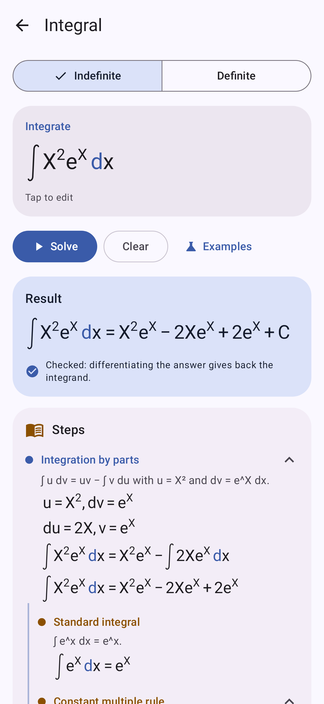

# Classy Calc

A native Android calculator, written in Kotlin with Jetpack Compose and Material 3, that brings the
main features of the Casio fx-CG50 to a phone. The centre of it is **natural display**: input and
results are drawn the way they are written, so 2/3 is a 2 placed over a 3, roots sit under a
radical sign, exponents are raised, and matrices are bracketed grids.

<p>
  
  
  
  
</p>

## Features

| Mode | What it does |
| --- | --- |
| **Run-Matrix** | Natural-display input with templates (fraction, mixed fraction, √, ˣ√, powers, logₐb, \|x\|, ∫, d/dx, d²/dx², Σ, Π, matrices). Exact results as fractions, surds and multiples of π (sin 60° = √3/2, √8 = 2√2, 1/(1+√2) = −1+√2) with **S⇔D** to switch to decimal. History you can tap to edit, Ans, variables A–Z/θ/r, Mat A–Z, List 1–26, store (→), complex numbers (a+bi and r∠θ), Casio operator priority (1÷2π = 1/(2π)). A live preview shows the answer to a simple calculation under the line as you type, without touching Ans. |
| **Statistics** | List editor for List 1–26, 1-variable and 2-variable statistics (with frequency list), regressions (linear, quadratic, cubic, quartic, logarithmic, exponential, power), scatter / xyLine / histogram / box plots with the regression curve. Copy a regression to Y=. |
| **Graph** | Ten function slots of type Y=, r=, parametric and X=; pinch to zoom (sideways zooms x, up and down zooms y, diagonally both), drag to pan; Trace; Zoom presets (Auto, Standard, Trig, Initial, Square, in/out); G-Solv (Root, Max, Min, Y-Intercept, Intersection, Y-Cal, X-Cal, ∫dx with shading); View Window. |
| **Table** | Values of the Y= functions over a start/end/step range. |
| **Equation** | Simultaneous linear equations (2–6 unknowns, exact fractions), polynomials of degree 2–6 (exact roots where they exist, complex roots included), and a Solver for any equation in any variable. |
| **Matrix** | Edit Mat A–Z (up to 10×10). Determinant, transpose, inverse (exact), Ref/Rref, identity, powers. |
| **Recursion** | Sequences aₙ and bₙ, explicit or recursive, tabulated with exact values. |
| **Base-N** | 32-bit integer arithmetic in Dec/Hex/Bin/Oct with and/or/xor/xnor/not/Neg; results shown in all four bases. |
| **Integral** | Step-by-step antiderivatives in natural display: sum and constant-multiple rules, a table of standard integrals, u-substitution (including u = √x, x = eᵘ and completing the square), partial fractions, integration by parts (including the e^x·sin x kind that comes back round), trigonometric and hyperbolic identities. Every answer is checked by differentiating it. Definite integrals give the exact F(b) − F(a) with its decimal value once numerical integration or a continuity check backs it up, fall back to numerical integration when no antiderivative is found, and say so when the integral does not converge (∫₋₁¹ 1/x² dx) or the value is out of range. Answers are read out by TalkBack. |
| **Derivative** | First, second and third derivatives with the rule used at each step (power, product, quotient, chain, logarithmic differentiation), and the exact value at a point (f′(π) = −π²). |
| **Settings** | Deg/Rad/Gra, Norm1/Norm2/Fix/Sci, Eng notation, Math or decimal output, d/c or ab/c fractions, Real/a+bi/r∠θ; theme, dynamic colour, accent colour, pure black, display text size, home screen particles, answer sparkles, reduce motion; live preview; keypad height, key shape, key spacing, key label size, SHIFT labels, key vibration and click; start screen and keep screen on; graph grid, axes, labels and line thickness; reset memory, history or settings. |

Function menus (**OPTN**) cover calculus, numeric (Int, Frac, Intg, Rnd, GCD, LCM, MOD), probability
(x!, nPr, nCr, Ran#, RanInt#), hyperbolic functions, angle units and °′″, complex functions, matrix
and list functions, distributions (Normal, Binomial, Poisson, Geometric, t, χ², F) and logic.
**VARS** inserts variables, matrices and lists and shows what they hold. Settings, variables,
lists, matrices, graph functions, equations and the calculation history are saved between launches.

The layout adapts to the window: a stacked keypad on phones, a wide keypad in landscape and on
unfolded foldables, and on a half-folded device the display and keypad sit on either side of the
fold. Back follows the predictive back gesture: the screen shrinks, rounds its corners and follows
your finger, with the previous screen dimmed behind it.

## Keypad

The keypad follows the CG50: tap **SHIFT** for the amber function printed above a key and **ALPHA**
for the red letter (SHIFT ALPHA locks letters). While a modifier is on, the keys show what they
will type. EXE is the ↵ key.

| Key | SHIFT | | Key | SHIFT |
| --- | --- | --- | --- | --- |
| log | 10ˣ | | 7 | ∫dx |
| ln | eˣ | | 8 | d/dx |
| sin cos tan | inverse | | 9 | Σ |
| fraction | mixed fraction | | 4 / 5 | nCr / nPr |
| √ | ˣ√ | | 6 | \|x\| |
| x² | ∛ | | × / ÷ | ° / Ran# |
| xʸ | logₐb | | 1 / 2 / 3 | List / Mat / new matrix |
| ( ) | { } | | + | e |
| OPTN | SET UP | | 0 | i |
| S⇔D | °′″ entry | | ×10ˣ | π |
| x⁻¹ | x! | | (−) | Ans |
| , | = | | EXE (↵) | ≈ (decimal result) |
| → | ∠ | | ◀ ▶ | start / end of line |

Typing a fraction straight after a number puts that number on top. On an empty line, an operator
continues from Ans, ▲ recalls earlier calculations, and ◀ or ▶ reopens the last one for editing.

## Install

Every push builds the APKs in GitHub Actions (**Actions → Build APK → Artifacts**, `classy-calc-apk`):

- `app-release.apk` — optimised (1.9 MB), signed with the standard debug key so it installs directly.
- `app-debug.apk` — unoptimised build for development.

Copy the APK to the phone and open it (allow installs from that source when Android asks).
Android 8.0 (API 26) or newer is required. On Android 13 and newer, turn on *Themed icons* in the
wallpaper settings and the launcher icon takes the wallpaper's colours.

## Build

Requires JDK 17+ and the Android SDK (platform 37). Then:

```
./gradlew assembleRelease                # unsigned: app/build/outputs/apk/release/app-release-unsigned.apk
./gradlew assembleRelease -PdebugSigned  # signed with the debug key, ready to install
./gradlew testDebugUnitTest              # engine, editor and UI tests
```

Screenshots in `app/src/test/screenshots` are produced by Robolectric/Roborazzi tests:
`./gradlew testDebugUnitTest -Proborazzi.test.record=true`.

The **Emulator QA** workflow installs the debug APK on an Android emulator and drives it with adb
(`scripts/qa/emulator-qa.sh`): it solves integrals and derivatives, types one on the keypad, changes
a keypad setting, and uploads screenshots, UI dumps and logs as the `android-qa-output` artifact.

## Releasing to F-Droid

The repository has what F-Droid builds from: the MIT licence, an unsigned release build without
Google's encrypted dependency block, and the store listing in `fastlane/metadata/android/en-US`
(title, descriptions, changelog per version code, icon and screenshots).

1. Merge to `main`, then tag the release: `git tag v1.0.0 && git push origin v1.0.0`. The listing
   and the version must already be in the tagged commit.
2. Fork [fdroiddata](https://gitlab.com/fdroid/fdroiddata) and, on a branch named after the app ID,
   copy `fdroid/io.github.l0gic0l.classycalc.yml` to `metadata/`. Replace `commit: v1.0.0` with
   the full hash from `git rev-parse v1.0.0^{commit}`, which F-Droid now asks for. Once the fork's
   CI pipeline passes, open a merge request titled `New App: io.github.l0gic0l.classycalc`.
3. For later versions, raise `versionCode` and `versionName` in `app/build.gradle.kts` (keep them
   plain literals: F-Droid reads them without running Gradle), add
   `fastlane/metadata/android/en-US/changelogs/<versionCode>.txt` and push a matching `vX.Y.Z` tag.
   F-Droid picks up new tags by itself.

## How it works

- `math/editor` — the natural-display input model: a tree of rows and templates with a cursor.
- `math/layout` — lays the tree out as boxes (fraction bars, radicals, raised exponents, stretched
  brackets) independent of Android; `ui/math/MathView` draws it with Compose.
- `math/parse` — turns the tree into an expression using the CG50 priority order.
- `math/num` — exact numbers of the form (a + b√r)·π^k with rational a, b, falling back to doubles,
  plus complex numbers, matrices and lists.
- `math/eval`, `math/numeric`, `math/graph` — evaluation, exact trigonometry, Gauss–Kronrod
  integration, root finding, polynomial roots, regressions, distributions and G-Solv.
- `math/cas` — symbolic expressions kept in a simplified canonical form, with derivatives and
  integrals that record each step for the Integral and Derivative modes.

## Not included

Programs, Python, eActivity, Spreadsheet, Conic graphs, Financial, E-CON, 3D graphs, Picture Plot,
Geometry and the statistical tests/intervals are outside this version.
