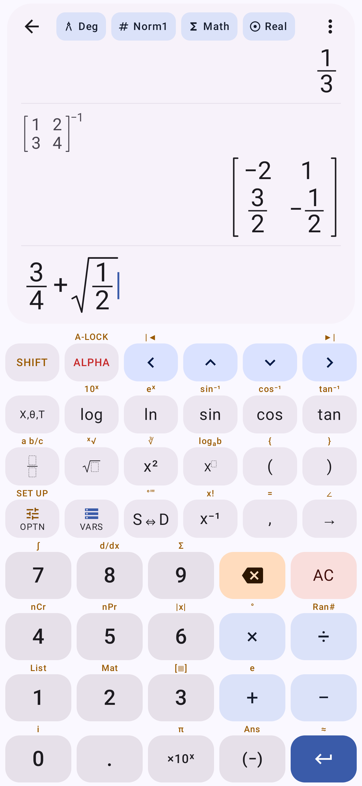
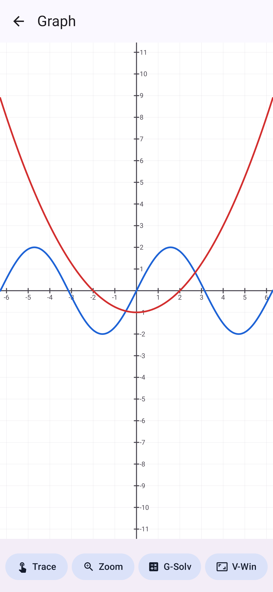
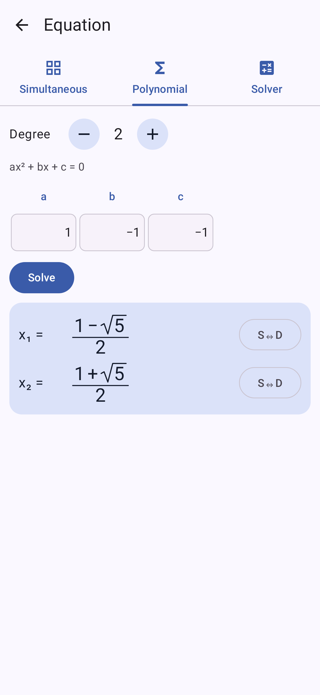

# CG Calc

A native Android calculator, written in Kotlin with Jetpack Compose and Material 3, that brings the
main features of the Casio fx-CG50 to a phone. The centre of it is **natural display**: input and
results are drawn the way they are written, so 2/3 is a 2 placed over a 3, roots sit under a
radical sign, exponents are raised, and matrices are bracketed grids.

<p>
  
  
  
</p>

## Features

| Mode | What it does |
| --- | --- |
| **Run-Matrix** | Natural-display input with templates (fraction, mixed fraction, √, ˣ√, powers, logₐb, \|x\|, ∫, d/dx, d²/dx², Σ, Π, matrices). Exact results as fractions, surds and multiples of π (sin 60° = √3/2, √8 = 2√2, 1/(1+√2) = −1+√2) with **S⇔D** to switch to decimal. History you can tap to edit, Ans, variables A–Z/θ/r, Mat A–Z, List 1–26, store (→), complex numbers (a+bi and r∠θ), Casio operator priority (1÷2π = 1/(2π)). |
| **Statistics** | List editor for List 1–26, 1-variable and 2-variable statistics (with frequency list), regressions (linear, quadratic, cubic, quartic, logarithmic, exponential, power), scatter / xyLine / histogram / box plots with the regression curve. Copy a regression to Y=. |
| **Graph** | Ten function slots of type Y=, r=, parametric and X=; pinch to zoom (sideways zooms x, up and down zooms y, diagonally both), drag to pan; Trace; Zoom presets (Auto, Standard, Trig, Initial, Square, in/out); G-Solv (Root, Max, Min, Y-Intercept, Intersection, Y-Cal, X-Cal, ∫dx with shading); View Window. |
| **Table** | Values of the Y= functions over a start/end/step range. |
| **Equation** | Simultaneous linear equations (2–6 unknowns, exact fractions), polynomials of degree 2–6 (exact roots where they exist, complex roots included), and a Solver for any equation in any variable. |
| **Matrix** | Edit Mat A–Z (up to 10×10). Determinant, transpose, inverse (exact), Ref/Rref, identity, powers. |
| **Recursion** | Sequences aₙ and bₙ, explicit or recursive, tabulated with exact values. |
| **Base-N** | 32-bit integer arithmetic in Dec/Hex/Bin/Oct with and/or/xor/xnor/not/Neg; results shown in all four bases. |
| **Settings** | Deg/Rad/Gra, Norm1/Norm2/Fix/Sci, Eng notation, Math or decimal output, d/c or ab/c fractions, Real/a+bi/r∠θ; theme, dynamic colour, pure black, display text size, particles, reduce motion; SHIFT labels, key vibration and click; keep screen on; graph grid, axes, labels and line thickness; reset memory, history or settings. |

Function menus (**OPTN**) cover calculus, numeric (Int, Frac, Intg, Rnd, GCD, LCM, MOD), probability
(x!, nPr, nCr, Ran#, RanInt#), hyperbolic functions, angle units and °′″, complex functions, matrix
and list functions, distributions (Normal, Binomial, Poisson, Geometric, t, χ², F) and logic.
**VARS** inserts variables, matrices and lists and shows what they hold. Settings, variables,
lists, matrices, graph functions, equations and the calculation history are saved between launches.

The layout adapts to the window: a stacked keypad on phones, a wide keypad in landscape and on
unfolded foldables, and on a half-folded device the display and keypad sit on either side of the
fold. Back follows the predictive back gesture: the screen shrinks, rounds its corners and follows
your finger, with the previous screen dimmed behind it.

## Keypad

The keypad follows the CG50: tap **SHIFT** for the amber function printed above a key and **ALPHA**
for the red letter (SHIFT ALPHA locks letters). While a modifier is on, the keys show what they
will type. EXE is the ↵ key.

| Key | SHIFT | | Key | SHIFT |
| --- | --- | --- | --- | --- |
| log | 10ˣ | | 7 | ∫dx |
| ln | eˣ | | 8 | d/dx |
| sin cos tan | inverse | | 9 | Σ |
| fraction | mixed fraction | | 4 / 5 | nCr / nPr |
| √ | ˣ√ | | 6 | \|x\| |
| x² | ∛ | | × / ÷ | ° / Ran# |
| xʸ | logₐb | | 1 / 2 / 3 | List / Mat / new matrix |
| ( ) | { } | | + | e |
| OPTN | SET UP | | 0 | i |
| S⇔D | °′″ entry | | ×10ˣ | π |
| x⁻¹ | x! | | (−) | Ans |
| , | = | | EXE (↵) | ≈ (decimal result) |
| → | ∠ | | ◀ ▶ | start / end of line |

Typing a fraction straight after a number puts that number on top. On an empty line, an operator
continues from Ans, ▲ recalls earlier calculations, and ◀ or ▶ reopens the last one for editing.

## Install

Every push builds the APKs in GitHub Actions (**Actions → Build APK → Artifacts**):

- `app-release.apk` — optimised (1.8 MB). It is signed with the standard debug key so it installs
  directly; sign it with your own key before publishing it anywhere.
- `app-debug.apk` — unoptimised build for development.

Copy the APK to the phone and open it (allow installs from that source when Android asks).
Android 8.0 (API 26) or newer is required.

## Build

Requires JDK 17+ and the Android SDK (platform 37). Then:

```
./gradlew assembleRelease      # app/build/outputs/apk/release/app-release.apk
./gradlew testDebugUnitTest    # engine, editor and UI tests
```

Screenshots in `app/src/test/screenshots` are produced by Robolectric/Roborazzi tests:
`./gradlew testDebugUnitTest -Proborazzi.test.record=true`.

## How it works

- `math/editor` — the natural-display input model: a tree of rows and templates with a cursor.
- `math/layout` — lays the tree out as boxes (fraction bars, radicals, raised exponents, stretched
  brackets) independent of Android; `ui/math/MathView` draws it with Compose.
- `math/parse` — turns the tree into an expression using the CG50 priority order.
- `math/num` — exact numbers of the form (a + b√r)·π^k with rational a, b, falling back to doubles,
  plus complex numbers, matrices and lists.
- `math/eval`, `math/numeric`, `math/graph` — evaluation, exact trigonometry, Gauss–Kronrod
  integration, root finding, polynomial roots, regressions, distributions and G-Solv.

## Not included

Programs, Python, eActivity, Spreadsheet, Conic graphs, Financial, E-CON, 3D graphs, Picture Plot,
Geometry and the statistical tests/intervals are outside this version.
